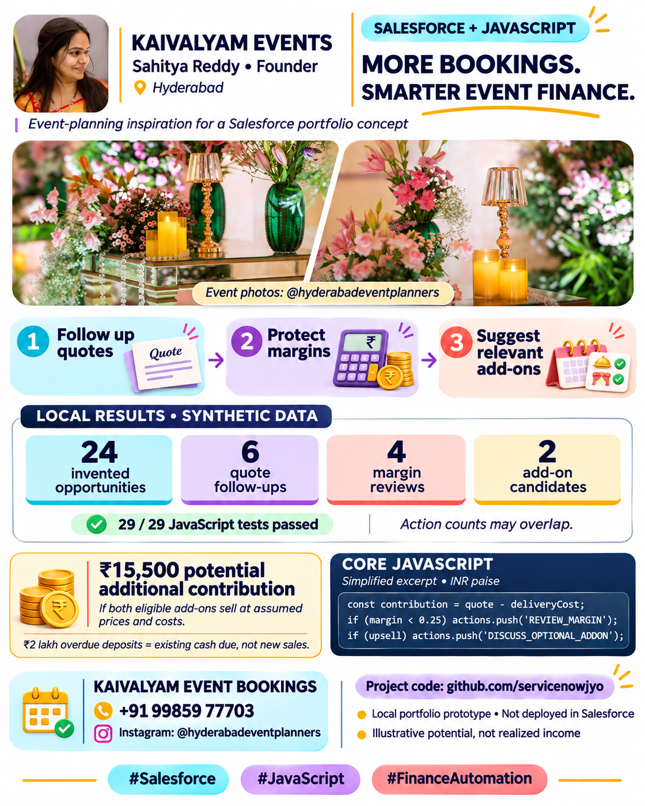
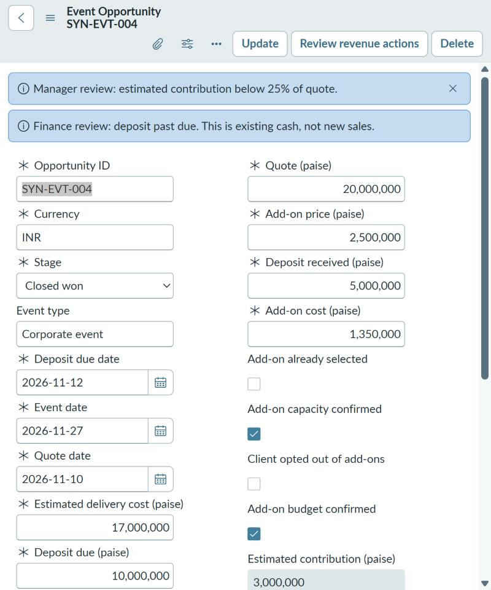

# Event Revenue Assistant — ServiceNow + JavaScript

Independent portfolio prototype for a Hyderabad event-planning business (inspired by Kaivalyam Events, run by the author's cousin). A ServiceNow scoped app flags quotes that need follow-up, quotes whose margin is too thin, deposits that are overdue, and bookings where an optional add-on is worth discussing. It only gives advice: it doesn't send messages, change quotes, apply discounts or take payments.

> **Status:** deployed and verified on a ServiceNow personal developer instance (Brazil release) on 14 Nov 2026. The instance gave the same results as the 32 local tests on all 24 records (see `results/servicenow_verification_2026-11-14.txt` and the screenshot in `results/screenshots/`). All data is synthetic. This is not a live business deployment, and no real revenue was measured.

## The opportunity being tested
| Business opportunity | What the app does |
|---|---|
| Quotes left without follow-up | Flags open quotes that are 3 or more days old |
| Discounts eating into earnings | Sends quotes with estimated contribution below 25% to manager review |
| Relevant extras left unsold | Suggests a profitable add-on only when capacity and budget are confirmed and the client hasn't opted out |
| Outstanding deposits | Flags overdue deposits for finance, kept separate from new sales |

These are hypotheses to check with the business owner. They are not observed problems at Kaivalyam.

## How it is built
```
servicenow/
  script_includes/EventRevenuePolicy.js   pure rule engine (ES5), the single source of truth
  script_includes/EventRevenueReview.js   GlideRecord adapter: reads records, writes advice fields
  scheduled_jobs/daily_review.scheduled_job.js
  ui_actions/review_revenue_actions.ui_action.js   "Review revenue actions" form button
  verification/verify_synthetic_import.background.js   instance-side check against local results
  schema/event_opportunity.fields.csv     table definition (24 fields)
src/policy.cjs   loads the Script Include unchanged into Node
src/run.cjs      local demo -> results/analysis.json
tests/           29 rule tests + 3 tests of the GlideRecord adapter on a mock GlideRecord
data/            24 synthetic opportunities (CSV/JSON) + deterministic generator
docs/            setup guide, solution write-up, pilot plan, sources
```

## Run it locally
You need Node 18 or later. There are no dependencies.
```
npm test       # 32 tests
npm run demo   # writes results/analysis.json
```

## Local results (synthetic, as of 14 Nov 2026)
24 valid records: 6 quote follow-ups, 4 margin reviews, 4 overdue-deposit reviews (₹2,00,000 of existing cash due) and 2 add-on candidates. If both add-ons sold at the assumed prices and costs, they would add ₹15,500 of contribution. The counts overlap, so don't add them up as separate clients. Measured income increase: **none, because nothing has been trialled**.

## Deploy to ServiceNow
Follow [`docs/SERVICENOW_SETUP.md`](docs/SERVICENOW_SETUP.md). It covers a free personal developer instance, the scoped app, the table, the Script Includes, importing the CSV, and a background script that should report `VERIFICATION PASSED`.

## Data
`data/DATASET_CARD.md` describes the dataset. It has 24 invented records with amounts in integer INR paise. Nothing came from Kaggle, Instagram or the business's own systems, and there are no client names or phone numbers.

## LinkedIn infographic kit
The `media/` folder holds two infographics, the prompts that generated them, captions, alt text and QA notes. Version 2 (`LinkedIn_Infographic_Kaivalyam_v2.png`) uses Kaivalyam's own decor photos and founder Sahitya Reddy's portrait plus the booking number, all included at the author's request. Sources are listed in `media/KAIVALYAM_PHOTO_CONTACT_SOURCES.md`. The photos and portrait are third-party material and are **not** covered by the MIT licence.

> Note: both infographic images were made for the earlier Salesforce version of this project and still say "Salesforce". They need to be regenerated before they are posted alongside this ServiceNow code.



## Screenshot from the developer instance


## Licence
The code is MIT licensed (see `LICENSE`). The photos, portrait and Kaivalyam business identity are excluded from it.
